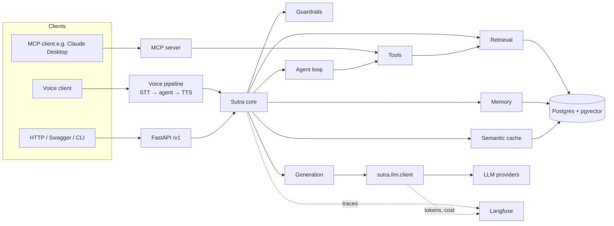
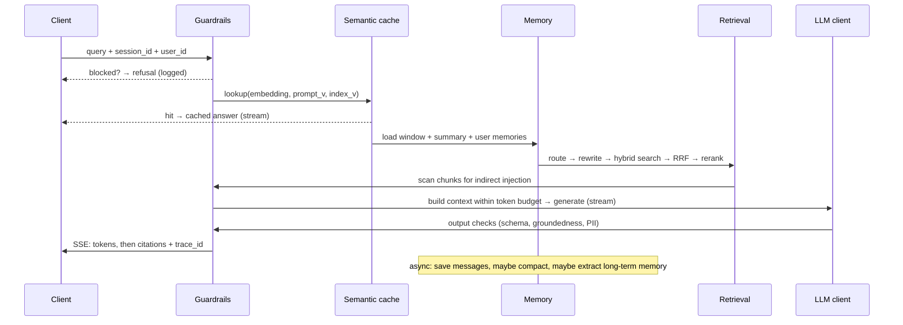

# Sutra — Architecture

> Sections are numbered so BUILD_PLAN phases can say "read §3 and §6" instead of the whole file.

---

## §1. System overview



**Key idea:** every client (HTTP, voice, MCP) goes through the **same core**. Guardrails, memory, and tracing
are written once and reused.

---

## §2. Request lifecycle (`POST /v1/chat`, RAG mode)



Each step is one **Langfuse span**. Agent mode (§8) swaps the fixed "retrieve → generate" middle
for a tool loop.

---

## §3. Ingestion

```
data/corpus/*.md
  → parse YAML front-matter (metadata)
  → chunk (strategy from config: recursive | semantic)
  → parent-child: small child chunks (~200 tokens) for search, parent sections (~800 tokens) for context
  → contextual prefix: LLM writes 1–2 sentences situating each chunk in its doc (cached by content hash)
  → embed (bge-small, 384d) + build tsvector
  → upsert into Postgres under index_version = hash(strategy + params + corpus)
```

- Re-ingesting with the same index_version is a no-op (idempotent).
- Several index versions can coexist, which is how ablations compare chunking strategies.

---

## §4. Retrieval pipeline

| Step | Module | Notes |
|---|---|---|
| 1. Route | `retrieval/router.py` | LLM classifier or rules → `{general, timeline, character, numeric, out_of_scope}`. Sets metadata filters or chooses a tool. |
| 2. Transform | `retrieval/query_transform.py` | rewrite (uses chat history), multi-query (n=3), HyDE. Each can be toggled in config. |
| 3. Search | `retrieval/search.py` | vector (cosine, HNSW) + keyword (Postgres FTS `ts_rank_cd`) in parallel, with optional metadata filter |
| 4. Fuse | `retrieval/fusion.py` | Reciprocal Rank Fusion, k=60 |
| 5. Rerank | `retrieval/rerank.py` | cross-encoder over the top 20 → keep the top 5 |
| 6. Expand | `retrieval/expand.py` | swap child chunks for their parent sections, dedupe |
| 7. Cite | `retrieval/citations.py` | stable ids `doc_slug#chunk_n` returned to the generator |

Every step can be switched by config, so `make eval` can run an ablation over any combination.

---

## §5. Generation & context management

- **Token budget** (`generation/budget.py`): `system + memory + history + chunks + answer reserve ≤ model window × safety`.
  Trim order when over budget: fewer chunks → shorter history → shorter summary.
- **Structured output:** `Answer{answer, citations[], confidence: float, refused: bool}`, validated with Pydantic.
- **Prompts:** `prompts/<name>.v<N>.md` with front-matter `{name, version, model_hint}`. The active versions are set in config.
- **Model routing:** a `fast` model for routing, rewriting, grading, and summaries; a `strong` model for answers; a fallback chain on error or timeout.
- **Prompt caching:** stable system prompt + instructions placed first so the provider can cache them.
- **Streaming:** SSE events `token`, `citations`, `meta` (trace_id, cost, cache_hit), `done`, `error`.

---

## §6. Memory

| Kind | Storage | Behavior |
|---|---|---|
| Short-term window | `messages` | last N turns go into the prompt verbatim |
| Rolling summary | `session_summaries` | when history > budget, the fast model compacts older turns into the summary (incremental) |
| Long-term | `user_memories` (+ embedding) | after a session ends or every K turns, extract durable user facts → dedupe → store. Retrieve the top 3 by similarity per query. |

**Memory guardrail:** never store secrets, PII, or injection text. The memory extractor runs output through the PII filter.

---

## §7. Semantic cache

- Key: query embedding. Hit when cosine ≥ threshold (default 0.95) **and** `prompt_version`, `index_version`, and `model` all match.
- Scope: per user by default, so one user's context doesn't leak into another's answers.
- Skipped when the session has history that changes meaning (e.g. pronouns). Only rewritten, standalone queries are cached.
- TTL plus explicit invalidation on re-ingest.

---

## §8. Agent (agentic RAG)

Hand-rolled loop in `agent/loop.py`:

```
while steps < max_steps and cost < cost_cap:
    llm(tools=allowlist) → tool_call | final_answer
    tool_call → guardrail check → execute → observation (truncated) → append
```

| Tool | Does |
|---|---|
| `search_lore(query, filters?)` | full retrieval pipeline §4 |
| `get_timeline(start?, end?, character?)` | filtered timeline chunks |
| `lookup_character(name)` | registry lookup, with alias match |
| `calculator(expression)` | safe math evaluation (no `eval`) |

- **Corrective RAG:** after `search_lore`, a grader scores relevance. If weak, the agent must rewrite and retry, at most 2 times.
- **MCP server** (`mcp_server/`): exposes the same 4 tools over stdio using the `mcp` SDK. Guardrails still apply.

---

## §9. Guardrails

| Stage | Checks | Action |
|---|---|---|
| Input | length, rate limit, prompt injection / jailbreak (heuristics + classifier LLM), PII detect + redact, topic scope | block, redact, or allow; always logged |
| Retrieval | indirect injection scan on chunks, ACL filter by `user_id` | drop chunk, log event |
| Output | schema validation, groundedness (claims vs cited chunks), PII leak, low-confidence → refusal | repair once, else refuse |
| Tool | allowlist, argument validation, max steps, cost cap | stop loop with a safe message |

Each guardrail is a class with `check(ctx) -> Verdict{allow|block|modify, reason, score}`, composed into a pipeline.
Every verdict becomes a trace event, which makes block rates measurable.

---

## §10. Observability

- **Langfuse:** one trace per request; spans for guardrails, cache, memory, route, transform, search, rerank, generate, and each tool call.
- **Recorded per LLM call:** model, prompt name + version, input/output tokens, cost (from a price table in config), latency, retries, fallback used.
- **Events:** guardrail verdicts, cache hit/miss, compaction run, memory saved.
- **Feedback:** `POST /v1/feedback` stores 👍/👎 + comment and sends a Langfuse score on the trace.
- Also structured JSON logs (with `trace_id`) to stdout.

---

## §11. Evaluation

```
evals/
  datasets/   golden_qa.jsonl, attacks.jsonl
  metrics/    retrieval.py (recall@k, MRR, context precision), judges.py (faithfulness, relevance, correctness), guardrails.py
  runners/    run_rag.py, run_agent.py, run_guardrails.py, ablation.py
  reports/    <date>_<config>.md + .json, baseline.json
```

- A run takes a **config profile** (`evals/profiles/*.yaml`), e.g. `naive.yaml`, `hybrid.yaml`, `hybrid_rerank.yaml`, `agentic.yaml`.
- Judges use the strong model with versioned judge prompts. About 10 rows are hand-labelled to check the judge.
- CI runs a **smoke subset** (about 10 rows) and compares against `baseline.json`.

---

## §12. Data model (Postgres)

```sql
documents(id, slug, title, doc_type, metadata jsonb, content_hash, created_at)
chunks(id, document_id, index_version, parent_id null, chunk_no, text, context_prefix,
       embedding vector(384), tsv tsvector, metadata jsonb, token_count)
       -- HNSW on embedding, GIN on tsv and metadata
sessions(id, user_id, created_at, last_active_at)
messages(id, session_id, role, content, prompt_version, trace_id, token_count, created_at)
session_summaries(session_id pk, summary, covers_until_message_id, updated_at)
user_memories(id, user_id, fact, embedding vector(384), source_session_id, created_at)
semantic_cache(id, user_id, query, query_embedding vector(384), answer jsonb,
               prompt_version, index_version, model, hits, created_at, expires_at)
feedback(id, trace_id, message_id, rating smallint, comment, created_at)
document_acl(document_id, user_id)   -- empty = public
```

Migrations use **Alembic**. Schema changes after Phase 2 need my OK.

---

## §13. API (`/v1`)

| Method | Path | Purpose |
|---|---|---|
| POST | `/chat` | `{query, session_id?, user_id, mode: rag|agent, stream: bool}` → SSE or JSON |
| POST | `/sessions` | create a session |
| GET | `/sessions/{id}/messages` | history |
| POST | `/feedback` | rating for a trace or message |
| POST | `/admin/ingest` | trigger ingestion (API-key protected) |
| GET | `/health` | DB + model readiness |

FastAPI's auto-generated OpenAPI at `/docs` is the full API reference.

---

## §14. Voice

```
8a DIY:      browser/CLI records → POST audio → STT → core (agent mode) → TTS → audio back
8b Pipecat:  WebRTC transport → VAD → STT (streaming) → Sutra processor (calls core) → TTS (streaming) → transport
8c Compare:  Gemini Live speech-to-speech with Sutra tools via function calling
```

- **Measured per pipeline:** STT latency, time to first token, time to first audio, total turn time.
- The voice path uses the **same guardrails and traces** (cascaded pipelines only; this is a known gap of 8c).

---

## §15. Infra

- `docker-compose.yml`: `postgres` (pgvector image), `langfuse` (+ its own DB services), `api`.
- Models (embedding, reranker) are downloaded once into a mounted cache volume.
- `.env.example` lists all keys. `Makefile` wraps the commands.
- GitHub Actions: lint + tests on every push; eval smoke run on PRs that touch `src/sutra/retrieval|generation|guardrails` or `prompts/`.
